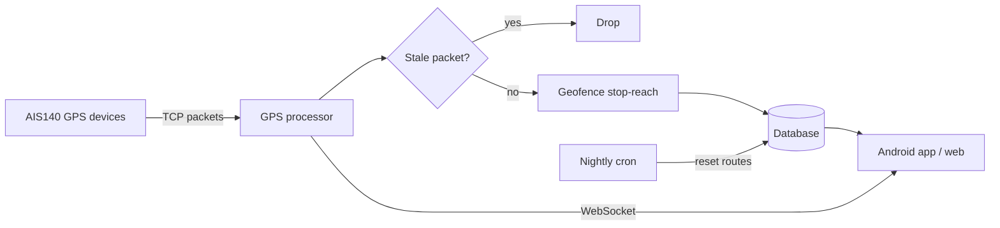

# SmartBus360: Showcase

**Real-time school-bus tracking for 4,000+ students.** Live at [smartbus360.com](https://smartbus360.com).

> This repository is a **documentation-only showcase** of freelance work. The production code and data belong to the client, so no code, credentials, device identifiers or customer data are published here.

## What it does

- Live bus location on a map for parents and students (near-instant updates over WebSocket)
- Automatic **stop-reach detection** from GPS devices: the stop list, reached times and route progress update with no driver input
- Admin dashboard for routes, stops, buses and institutes, with live Online/Offline fleet filters and per-bus GPS freshness
- Attendance for students: a coordinator module (pickup, drop and half-day with times) and a driver module, both with QR and manual marking
- Android, iOS and web clients
- Used daily by 100+ concurrent students

## My role

Freelance full-stack developer owning the production backend and shipping fixes to the Android app.

| Problem | What I did |
|---|---|
| GPS-device buses had no server-side stop detection | Built a geofence service: the nearest pending stop within a configurable radius (300 m default) is marked reached, with reach time and an audit log |
| Bus marker jumped forward and back on the map | Found that devices also send buffered history packets. Decoded device timestamps and dropped stale packets per device |
| Stale route state each morning | Added a nightly scheduled job that resets GPS routes to the morning round |
| Stops stuck in a null state (105 stops, 8 routes) | Treated null as pending, fixed time handling to IST and corrected a log-insert bug |
| "Default Time: Error" in the Android app | Traced it to empty or `HH:mm` schedule values on 2,897 stops; made the time formatting tolerant |
| Home-screen ETA accumulated down the stop list | Switched to direct bus-to-stop ETA |
| Risky production patches | Backups before each change, syntax checks before restarts, and log checks after |

### Recent work (November 2026)

| Problem | What I did |
|---|---|
| Student app showed "Driver offline" on GPS-device buses after connectivity logic meant for phone-based buses leaked into the GPS path | Separated the two sources. The app now reads the bus's location source (set in the web admin) from the API; GPS buses always show Online with a colour-coded "last GPS update" time (green under 5 min, orange under 30, red after), and the map opens on the last saved GPS position |
| Bus Location screen blocked on a loader, or showed a white screen, on weak 2G networks and after the app sat idle | Restored a status prompt ("Checking connection" / "Checking map access") with a timeout that opens the map anyway, and a clean map reload when the app returns from a long idle period |
| ETA time frozen for hours on iOS (for example "9:54 AM" never changed) | Root cause: the ETA calculation was skipped whenever the bus had moved less than 10 m. Added a fixed-interval recalculation so a stationary bus keeps refreshing (fix in review) |
| Attendance screens felt slow | Optimistic updates with rollback on failure, so marking attendance shows instantly while the server syncs in the background; faster screen transitions |
| QR login failing on slow networks | Silent background retry for up to two minutes; the exchange is idempotent, so repeating it is safe |
| Coordinator and admin screens needed a redesign | Bus lists with half-day counts, read-only "Picked / Dropped" indicators with times, profile pictures with a pop-out zoom, a styled exit confirmation, trimmed login credentials, and an admin header with back, refresh and logout |
| Google Play 16 KB page-size requirement | Audited every native library in the built APK, found two that were not aligned (a map SDK pulled in by an unused screen and an older CameraX), upgraded one and removed the other. APK size dropped from 92 MB to 55 MB. Target and compile SDK moved to 36 |
| About, Terms and Privacy pages copyable or screenshot-able | Native in-app legal screens with no text selection and screenshots blocked on Android; content hidden during screen recording on iOS |
| Website search visibility and login page | Keyword strategy, canonical and language tags, and JSON-LD structured data (Organization, Person, SoftwareApplication, WebSite, About); rebuilt the admin login page responsive and animated, hid broken carousel images, and fixed a mixed-content map-tile problem that left some maps blank |

## Architecture

## Tech stack

Node.js · Express · Sequelize · Socket.IO · PM2 · Nginx · Linux · Kotlin and Jetpack Compose (Android) · SwiftUI (iOS) · React, Vite and Tailwind (web) · CameraX · JSON-LD · AIS140 GPS devices

## Contact

Aditya Sharma: [LinkedIn](https://linkedin.com/in/addityaasharma) · addityaasharma@gmail.com
