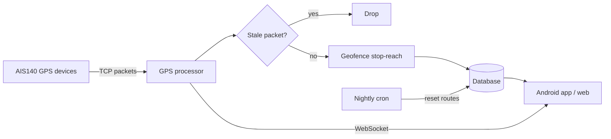

# SmartBus360: Showcase

**Real-time school-bus tracking for 4,000+ students.** Live at [smartbus360.com](https://smartbus360.com).

> This repository is a **documentation-only showcase** of freelance work. The production code and data belong to the client, so no code, credentials, device identifiers or customer data are published here.

## What it does

- Live bus location on a map for parents and students (near-instant updates over WebSocket)
- Automatic **stop-reach detection** from GPS devices: the stop list, reached times and route progress update with no driver input
- Admin tools for routes, stops, buses and institutes
- Used daily by 100+ concurrent students

## My role

Freelance full-stack developer owning the production backend and shipping fixes to the Android app.

| Problem | What I did |
|---|---|
| GPS-device buses had no server-side stop detection | Built a geofence service: the nearest pending stop within a configurable radius (300 m default) is marked reached, with reach time and an audit log |
| Bus marker jumped forward and back on the map | Found that devices also send buffered history packets. Decoded device timestamps and dropped stale packets per device |
| Stale route state each morning | Added a nightly scheduled job that resets GPS routes to the morning round |
| Stops stuck in a null state (105 stops, 8 routes) | Treated null as pending, fixed time handling to IST and corrected a log-insert bug |
| "Default Time: Error" in the Android app | Traced it to empty or `HH:mm` schedule values on 2,897 stops; made the time formatting tolerant |
| Home-screen ETA accumulated down the stop list | Switched to direct bus-to-stop ETA |
| Risky production patches | Backups before each change, syntax checks before restarts, and log checks after |

## Architecture

## Tech stack

Node.js · Express · Sequelize · Socket.IO · PM2 · Nginx · Linux · Kotlin (Android) · AIS140 GPS devices

## Contact

Aditya Sharma: [LinkedIn](https://linkedin.com/in/addityaasharma) · addityaasharma@gmail.com
